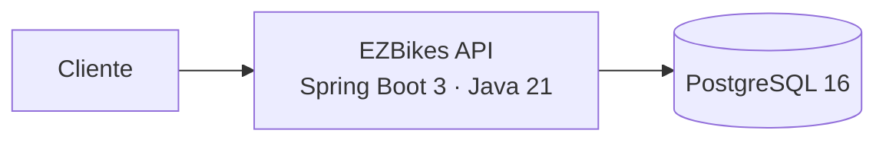

# Projeto-Aplicado1-EZBIKES

**EZBikes** é uma loja virtual de bicicletas construída como um sistema **observável**: além de vender, ela produz logs estruturados, métricas de negócio e de desempenho, SLOs com error budget e alertas de burn rate. O projeto foi desenvolvido para o Projeto Aplicado I da pós-graduação (disciplina *Observabilidade, SRE e Engenharia de Confiabilidade de Sistemas*).

> 🚧 Em construção. Esta página será ampliada a cada etapa do cronograma até a entrega.

## Status do cronograma

| Etapa | Situação |
|---|---|
| Esqueleto Spring Boot, Docker Compose, PostgreSQL, Flyway e catálogo inicial | ✅ |
| Carrinho, pedidos, estoque transacional e tratamento de erros | ✅ |
| Logs JSON + ELK (Elasticsearch, Logstash, Kibana) | ⏳ |
| Métricas (Actuator, Micrometer, Prometheus) e recording rules | ⏳ |
| Dashboards Grafana (Golden Signals, SLO/Error Budget, Negócio) e alertas de burn rate | ⏳ |
| Injeção de falhas e testes de carga com k6 | ⏳ |
| Vitrine HTML/JS e CI no GitHub Actions | ⏳ |
| Evidências, SLOs documentados e reflexão crítica | ⏳ |

## Mapeamento: conteúdo da pós → implementação

| Conteúdo | Aplicação na EZBikes |
|---|---|
| Logs estruturados | Pedidos, erros e consultas ao estoque registrados em JSON |
| ELK Stack | Investigação de falhas no checkout pelo Kibana |
| Prometheus | Coleta de métricas da API e de negócio |
| Grafana | Dashboards operacionais e de negócio |
| Golden Signals | Latência, tráfego, erros e saturação |
| SLI e SLO | Metas de disponibilidade do checkout e latência do catálogo |
| Error Budget | Margem de falhas permitidas no período |
| Burn Rate | Alertas multi-janela sobre consumo acelerado do budget |
| k6 | Simulação de múltiplos clientes acessando a loja |

## Arquitetura (estado atual)



## Como executar

Pré-requisito: Docker com Docker Compose. Não é preciso ter Java nem Maven instalados, porque a API é compilada dentro do container.

```bash
docker compose up -d --build
```

| Recurso | URL |
|---|---|
| Catálogo (API) | http://localhost:8080/api/products |
| Filtro por categoria/marca | http://localhost:8080/api/products?category=MTB&brand=Caloi |
| Health check | http://localhost:8080/actuator/health |

Para parar e apagar os dados: `docker compose down -v`.

## API

| Método | Rota | Descrição |
|---|---|---|
| GET | `/api/products?category=&brand=` | Catálogo com filtros opcionais |
| GET | `/api/products/{id}` | Detalhe do produto |
| GET | `/api/carts/{cartId}` | Carrinho (o `cartId` é gerado pelo cliente, por exemplo um UUID) |
| POST | `/api/carts/{cartId}/items` | Adiciona item: `{"productId": 1, "quantity": 2}` |
| DELETE | `/api/carts/{cartId}/items/{productId}` | Remove item |
| DELETE | `/api/carts/{cartId}` | Esvazia o carrinho |
| POST | `/api/orders` | Checkout a partir do carrinho (`cartId`) ou de uma lista de `items` |
| GET | `/api/orders/{id}` | Consulta o pedido |

Exemplo de checkout direto:

```bash
curl -X POST http://localhost:8080/api/orders -H "Content-Type: application/json" \
  -d '{"customerName":"Ana","customerEmail":"ana@example.com","items":[{"productId":1,"quantity":1}]}'
```

### Fluxo do checkout

1. **Reserva:** baixa o estoque com um `UPDATE ... WHERE stock >= qty` atômico e grava o pedido como `CREATED`. Se faltar estoque em qualquer item, a transação inteira é desfeita.
2. **Pagamento:** chama o gateway simulado *fora* de transação, para não prender conexões do pool enquanto espera uma dependência externa.
3. **Conclusão:** marca `PAID`; se o gateway falhar, marca `PAYMENT_FAILED` e devolve o estoque.

O pagamento é **simulado** (não há integração financeira). A taxa de falha do gateway é configurável por `EZBIKES_PAYMENT_FAILURE_RATE` (0 a 1) e servirá para os experimentos de confiabilidade.

### Erros e o error budget

Os erros seguem o formato RFC 7807 (`application/problem+json`). A classificação do status define o que conta como falha do serviço no SLI de disponibilidade:

| Situação | Status | Consome o error budget? |
|---|---|---|
| Dados inválidos, carrinho vazio | 400 | Não (erro do cliente) |
| Produto ou pedido inexistente | 404 | Não |
| Estoque insuficiente | 409 | Não (regra de negócio) |
| Falha do gateway de pagamento | 502 | **Sim** |
| Erro inesperado | 500 | **Sim** |

## Testes

```bash
cd api
./mvnw verify
```

Os testes de integração usam **Testcontainers** com PostgreSQL 16 real e cobrem: pedido pago e baixa de estoque, rollback quando falta estoque, devolução do estoque quando o pagamento falha, checkout pelo carrinho, mapeamento dos status HTTP e **20 compras concorrentes** de um produto com 5 unidades (exatamente 5 são vendidas).

Sem Java instalado, rode os testes dentro de um container Maven:

```bash
cd api
docker run --rm -v "$PWD":/w -v ezbikes-m2:/root/.m2 \
  -v /var/run/docker.sock:/var/run/docker.sock \
  -e TESTCONTAINERS_HOST_OVERRIDE=host.docker.internal \
  -w /w maven:3.9-eclipse-temurin-21 mvn -B verify
```

## Estrutura

```
api/                 API Spring Boot (código, migrações Flyway, Dockerfile)
docker-compose.yml   Orquestração local
```
