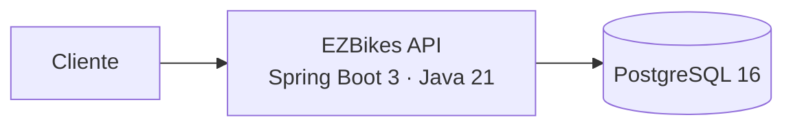

# Projeto-Aplicado1-EZBIKES

**EZBikes** é uma loja virtual de bicicletas construída como um sistema **observável**: além de vender, ela produz logs estruturados, métricas de negócio e de desempenho, SLOs com error budget e alertas de burn rate. O projeto foi desenvolvido para o Projeto Aplicado I da pós-graduação (disciplina *Observabilidade, SRE e Engenharia de Confiabilidade de Sistemas*).

> 🚧 Em construção. Esta página será ampliada a cada etapa do cronograma até a entrega.

## Status do cronograma

| Etapa | Situação |
|---|---|
| Esqueleto Spring Boot, Docker Compose, PostgreSQL, Flyway e catálogo inicial | ✅ |
| Carrinho, pedidos, estoque transacional e tratamento de erros | ⏳ |
| Logs JSON + ELK (Elasticsearch, Logstash, Kibana) | ⏳ |
| Métricas (Actuator, Micrometer, Prometheus) e recording rules | ⏳ |
| Dashboards Grafana (Golden Signals, SLO/Error Budget, Negócio) e alertas de burn rate | ⏳ |
| Injeção de falhas e testes de carga com k6 | ⏳ |
| Vitrine HTML/JS e CI no GitHub Actions | ⏳ |
| Evidências, SLOs documentados e reflexão crítica | ⏳ |

## Mapeamento: conteúdo da pós → implementação

| Conteúdo | Aplicação na EZBikes |
|---|---|
| Logs estruturados | Pedidos, erros e consultas ao estoque registrados em JSON |
| ELK Stack | Investigação de falhas no checkout pelo Kibana |
| Prometheus | Coleta de métricas da API e de negócio |
| Grafana | Dashboards operacionais e de negócio |
| Golden Signals | Latência, tráfego, erros e saturação |
| SLI e SLO | Metas de disponibilidade do checkout e latência do catálogo |
| Error Budget | Margem de falhas permitidas no período |
| Burn Rate | Alertas multi-janela sobre consumo acelerado do budget |
| k6 | Simulação de múltiplos clientes acessando a loja |

## Arquitetura (estado atual)



## Como executar

Pré-requisito: Docker com Docker Compose. Não é preciso ter Java nem Maven instalados, porque a API é compilada dentro do container.

```bash
docker compose up -d --build
```

| Recurso | URL |
|---|---|
| Catálogo (API) | http://localhost:8080/api/products |
| Filtro por categoria/marca | http://localhost:8080/api/products?category=MTB&brand=Caloi |
| Health check | http://localhost:8080/actuator/health |

Para parar e apagar os dados: `docker compose down -v`.

## Estrutura

```
api/                 API Spring Boot (código, migrações Flyway, Dockerfile)
docker-compose.yml   Orquestração local
```
