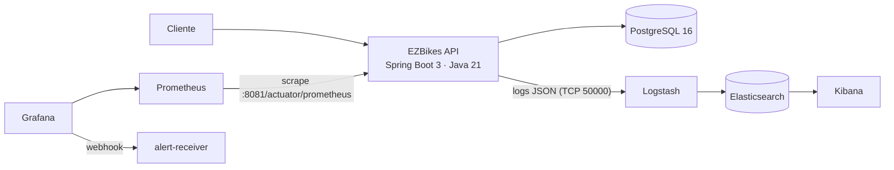

# Projeto-Aplicado1-EZBIKES

[](https://github.com/EnzoOliveiradev/Projeto-Aplicado1-EZBIKES/actions/workflows/ci.yml)

**EZBikes** é uma loja virtual de bicicletas construída como um sistema **observável**: além de vender, ela produz logs estruturados, métricas de negócio e de desempenho, SLOs com error budget e alertas de burn rate. O projeto foi desenvolvido para o Projeto Aplicado I da pós-graduação (disciplina *Observabilidade, SRE e Engenharia de Confiabilidade de Sistemas*).

> 🚧 Em construção. Esta página será ampliada a cada etapa do cronograma até a entrega.

## Status do cronograma

| Etapa | Situação |
|---|---|
| Esqueleto Spring Boot, Docker Compose, PostgreSQL, Flyway e catálogo inicial | ✅ |
| Carrinho, pedidos, estoque transacional e tratamento de erros | ✅ |
| Logs JSON + ELK (Elasticsearch, Logstash, Kibana) | ✅ |
| Métricas (Actuator, Micrometer, Prometheus) e recording rules | ✅ |
| Dashboards Grafana (Golden Signals, SLO/Error Budget, Negócio) e alertas de burn rate | ✅ |
| Injeção de falhas e testes de carga com k6 | ✅ |
| Vitrine HTML/JS e CI no GitHub Actions | ✅ |
| Evidências (prints e resultados) e SLOs documentados | ✅ |
| Reflexão crítica, roteiro da demonstração e revisão final | ⏳ |

## Mapeamento: conteúdo da pós → implementação

| Conteúdo | Aplicação na EZBikes |
|---|---|
| Logs estruturados | Pedidos, erros e consultas ao estoque registrados em JSON |
| ELK Stack | Investigação de falhas no checkout pelo Kibana |
| Prometheus | Coleta de métricas da API e de negócio |
| Grafana | Dashboards operacionais e de negócio |
| Golden Signals | Latência, tráfego, erros e saturação |
| SLI e SLO | Metas de disponibilidade do checkout e latência do catálogo |
| Error Budget | Margem de falhas permitidas no período |
| Burn Rate | Alertas multi-janela sobre consumo acelerado do budget |
| k6 | Simulação de múltiplos clientes acessando a loja |

## Arquitetura (estado atual)



## Como executar

Pré-requisitos: Docker com Docker Compose e **pelo menos 4 GB de memória** disponíveis para o Docker (o Elasticsearch, o Logstash e o Kibana são os serviços mais pesados). Não é preciso ter Java nem Maven instalados, porque a API é compilada dentro do container.

A primeira subida leva alguns minutos: o Kibana demora a ficar disponível.

```bash
docker compose up -d --build
```

| Recurso | URL |
|---|---|
| **Loja (vitrine)** | http://localhost:8080 |
| Catálogo (API) | http://localhost:8080/api/products |
| Filtro por categoria/marca | http://localhost:8080/api/products?category=MTB&brand=Caloi |
| Health check | http://127.0.0.1:8081/actuator/health |
| Métricas (formato Prometheus) | http://127.0.0.1:8081/actuator/prometheus |
| Prometheus | http://localhost:9090 |
| Grafana | http://localhost:3000 (usuário `admin`, senha `ezbikes`, configuráveis no `.env`) → Dashboards → EZBikes |
| Kibana (logs) | http://localhost:5601 → Dashboards → **EZBikes · Logs**, ou Discover → data view **EZBikes - logs** |
| Elasticsearch | http://localhost:9200 |

Para parar e apagar os dados: `docker compose down -v`.

## Vitrine

A loja tem uma vitrine simples em HTML, CSS e JavaScript puro, servida pela própria API em http://localhost:8080 (arquivos em [`api/src/main/resources/static`](api/src/main/resources/static)):

- **Catálogo** com filtros por categoria e marca;
- **Produto** com quantidade e "Adicionar ao carrinho";
- **Carrinho** com remoção de itens e formulário de checkout (nome e e-mail);
- **Pedido** com a confirmação, a situação e o número do pedido.

Ela foi pensada para a demonstração de observabilidade:
- quando o pagamento falha, a tela mostra o **código de atendimento**, que é o `X-Request-Id` devolvido pela API. No Kibana, `trace_id: "<código>"` mostra exatamente o que aconteceu naquela tentativa;
- a página do pedido mostra o `order_id` e a busca pronta para o Kibana.

Os dados da API entram na página só por `textContent` (nunca `innerHTML`), o que evita injeção de HTML. O `cartId` fica no `localStorage`; se o navegador bloquear o armazenamento, a loja continua funcionando na sessão. O visual acompanha o tema claro ou escuro do sistema.

## API

| Método | Rota | Descrição |
|---|---|---|
| GET | `/api/products?category=&brand=` | Catálogo com filtros opcionais |
| GET | `/api/products/{id}` | Detalhe do produto |
| GET | `/api/carts/{cartId}` | Carrinho (o `cartId` é gerado pelo cliente, por exemplo um UUID) |
| POST | `/api/carts/{cartId}/items` | Adiciona item: `{"productId": 1, "quantity": 2}` |
| DELETE | `/api/carts/{cartId}/items/{productId}` | Remove item |
| DELETE | `/api/carts/{cartId}` | Esvazia o carrinho |
| POST | `/api/orders` | Checkout a partir do carrinho (`cartId`) ou de uma lista de `items` |
| GET | `/api/orders/{id}` | Consulta o pedido |

Exemplo de checkout direto:

```bash
curl -X POST http://localhost:8080/api/orders -H "Content-Type: application/json" \
  -d '{"customerName":"Ana","customerEmail":"ana@example.com","items":[{"productId":1,"quantity":1}]}'
```

### Fluxo do checkout

1. **Reserva:** baixa o estoque com um `UPDATE ... WHERE stock >= qty` atômico e grava o pedido como `CREATED`. Se faltar estoque em qualquer item, a transação inteira é desfeita.
2. **Pagamento:** chama o gateway simulado *fora* de transação, para não prender conexões do pool enquanto espera uma dependência externa.
3. **Conclusão:** marca `PAID`; se o gateway falhar, marca `PAYMENT_FAILED` e devolve o estoque.

O pagamento é **simulado** (não há integração financeira). A taxa de falha do gateway começa com o valor de `EZBIKES_PAYMENT_FAILURE_RATE` (0 a 1) e pode ser alterada em tempo de execução pela API administrativa.

### API administrativa (experimentos de caos)

Ligada no compose de demonstração (`EZBIKES_ADMIN_ENABLED=true`) e protegida pelo cabeçalho `X-Admin-Token` (variável `EZBIKES_ADMIN_TOKEN`, padrão `demo-admin-token-troque`). Fora do compose ela fica desligada e as rotas nem existem.

| Método | Rota | Descrição |
|---|---|---|
| GET | `/admin/chaos` | Falhas ativas |
| PUT | `/admin/chaos` | `{"paymentFailureRate": 0.05, "errorRate": 0, "extraLatencyMs": 0, "latencyScope": "ALL"}` |
| DELETE | `/admin/chaos` | Desliga todas as falhas |
| POST | `/admin/stock/replenish` | `{"quantity": 1000}` repõe o estoque de todo o catálogo |

- `paymentFailureRate`: o gateway de pagamento falha (502) nessa proporção dos checkouts.
- `errorRate`: requisições a `/api/**` falham com 503 nessa proporção.
- `extraLatencyMs` + `latencyScope` (`ALL`, `CATALOG`, `CHECKOUT`): atraso adicional nas rotas escolhidas.

As falhas são aplicadas por um *interceptor* do Spring MVC, depois do mapeamento da rota: as métricas registram a URI real (`/api/products/{id}`) e a falha injetada entra no SLI exatamente como uma falha de verdade. Cada mudança gera um log `event.action: "chaos.updated"`.

```bash
curl -X PUT http://localhost:8080/admin/chaos -H "X-Admin-Token: demo-admin-token-troque"   -H "Content-Type: application/json" -d '{"paymentFailureRate": 0.05}'
```

### Erros e o error budget

Os erros seguem o formato RFC 7807 (`application/problem+json`). A classificação do status define o que conta como falha do serviço no SLI de disponibilidade:

| Situação | Status | Consome o error budget? |
|---|---|---|
| Dados inválidos, carrinho vazio | 400 | Não (erro do cliente) |
| Produto ou pedido inexistente | 404 | Não |
| Estoque insuficiente | 409 | Não (regra de negócio) |
| Falha do gateway de pagamento | 502 | **Sim** |
| Erro inesperado | 500 | **Sim** |

## Logs estruturados e ELK

Todos os logs saem em **JSON** (`logstash-logback-encoder`), no console e, no profile `demo` do compose, também via TCP para o Logstash. O Logstash grava em índices diários `app-logs-AAAA.MM.DD`.

**Campos principais**

| Campo | Origem | Exemplo |
|---|---|---|
| `@timestamp`, `level`, `message`, `logger` | Logback | `ERROR` |
| `service`, `environment` | fixos | `ezbikes-api`, `demo` |
| `trace_id` | `X-Request-Id` recebido ou gerado (MDC) | `demo-order-0004` |
| `http.method`, `http.path` | MDC | `POST`, `/api/orders` |
| `http.route` | log de acesso (template da rota) | `/api/products/{id}` |
| `http.status`, `http.duration_ms` | log de acesso (numéricos) | `502`, `87` |
| `event.action` | eventos de negócio (nome do ECS) | `order.payment_failed` |
| `order_id` | MDC durante o checkout | UUID do pedido |
| `order_total`, `items_count`, `sku`, `payment_reason`, `stock_remaining` | argumentos estruturados | `5999.00` |
| `customer_email` | **mascarado** | `m***@example.com` |

**Eventos de negócio:** `order.created`, `order.paid`, `order.payment_failed` (ERROR), `order.rejected_out_of_stock` (WARN), `stock.low` (WARN, estoque abaixo de 3), `error.unexpected` (ERROR) e `http.access` (um por requisição; WARN para 5xx).

A API devolve o `trace_id` no cabeçalho `X-Request-Id`, para o cliente informar ao suporte. Requisições a `/actuator/**` (health check e scraping) ficam fora do log de acesso para não gerar ruído.

**Dashboard e buscas salvas:** o `kibana-setup` importa [`saved-objects.ndjson`](observability/kibana/saved-objects.ndjson) (gerado por [`build_saved_objects.py`](observability/kibana/build_saved_objects.py)) com o dashboard **EZBikes · Logs** (logs por nível, eventos de pedidos ao longo do tempo, top 5 mensagens de erro, duração por rota e falhas de pagamento) e as buscas salvas *Erros*, *Falhas de pagamento*, *Eventos de pedidos*, *Requisições lentas (> 300 ms)* e *Experimentos de caos*.

O log de acesso traz `http.route`, o template da rota (`/api/products/{id}`), para agregar por rota sem que cada ID vire uma linha diferente.

**Consultas KQL úteis no Kibana**

```
level: "ERROR"
event.action: "order.payment_failed"
order_id: "<id do pedido>"                 # história completa de um pedido
trace_id: "<X-Request-Id>"                  # todos os logs de uma requisição
http.status >= 500
http.duration_ms > 100 and http.path: "/api/orders"
event.action: "stock.low"
```

**Privacidade (LGPD):** o e-mail é mascarado na aplicação (`PiiMasker`) e, como segunda camada, o Logstash mascara qualquer e-mail que chegue em texto claro no campo `message` e descarta o `event.original` (a linha bruta). O nome do cliente nunca é registrado nos logs. A resposta da API também não devolve o e-mail.

**Retenção e custo:** o serviço `elk-setup` cria uma política ILM que **apaga índices com mais de 7 dias** e um index template com os tipos de cada campo (`http.status` numérico, IDs como `keyword`), 1 shard e 0 réplicas (nó único). O `kibana-setup` cria a data view. Os dois rodam uma vez a cada `docker compose up` e são idempotentes.

**Resiliência:** a API não depende do Logstash para subir. Se o pipeline de logs cair, a loja continua atendendo e o appender reconecta sozinho.

## Métricas (Prometheus)

A API expõe métricas pelo Actuator + Micrometer em `/actuator/prometheus`. O Prometheus coleta a cada 15 s (modelo *pull*) e guarda 30 dias, a mesma janela dos SLOs.

**Segurança:** o Actuator roda numa **porta de gestão separada (8081)**, publicada só em `127.0.0.1`. A porta pública da loja (8080) responde 404 para `/actuator/prometheus`, porque as métricas de negócio (receita, volume de pedidos) não devem ficar expostas a clientes. O Prometheus acessa a 8081 pela rede interna do Docker.

### Métricas de negócio

| Métrica (Prometheus) | Tipo | Labels | Uso |
|---|---|---|---|
| `ezbikes_orders_total` | Counter | `status`: paid, payment_failed, out_of_stock, rejected, error | volume e resultado dos pedidos |
| `ezbikes_checkout_duration_seconds` | Timer (histograma) | `outcome` | latência do checkout de ponta a ponta |
| `ezbikes_order_value_reais` | DistributionSummary | — | receita (`_sum`) e ticket médio (`_sum / _count`) |
| `ezbikes_cart_items_added_total` | Counter | `category` | interesse por categoria, conversão |
| `ezbikes_payment_gateway_duration_seconds` | Timer (histograma) | `outcome`: success, failure | latência da dependência externa |
| `ezbikes_payment_gateway_failures_total` | Counter | `reason` | falhas do gateway por motivo |
| `ezbikes_product_stock` | Gauge | `sku`, `category` | estoque por produto (atualizado a cada 15 s, sem consultar o banco no scrape) |

Além delas, o Spring Boot publica as métricas técnicas usadas nas Golden Signals: `http_server_requests_seconds` (histograma com buckets exatos em 100 ms, 300 ms, 500 ms e 1 s), `process_cpu_usage`, `jvm_memory_used_bytes`, `hikaricp_connections_active` e `tomcat_threads_busy_threads`. Todas as séries levam o label `application="ezbikes-api"`.

**Cardinalidade:** os labels têm conjuntos pequenos e fechados. Identificadores como `order_id`, cliente ou e-mail **nunca** viram label, porque cada valor distinto criaria uma série temporal nova. Eles ficam nos logs, onde a busca por valor único é barata. A URI das requisições usa o *template* (`/api/products/{id}`), não o caminho real.

**Correspondência com a aula:** o material usa nomes genéricos; no Spring Boot eles são:

| Aula | EZBikes (Micrometer) |
|---|---|
| `http_requests_total` | `http_server_requests_seconds_count` |
| `http_request_duration_bucket` | `http_server_requests_seconds_bucket` |
| label `status` | `status` (também há `outcome`: SUCCESS, CLIENT_ERROR, SERVER_ERROR) |

### Recording rules e SLIs

As regras em [`observability/prometheus/rules/recording.yml`](observability/prometheus/rules/recording.yml) pré-calculam os SLIs nas janelas de 5m, 30m, 1h, 6h, 1d e 30d:

| SLI | Série gravada | Definição |
|---|---|---|
| Disponibilidade do checkout | `ezbikes:checkout_error_ratio:rate<janela>` | `POST /api/orders` com 5xx ÷ total (4xx não contam) |
| Latência do catálogo | `ezbikes:catalog_latency_good_ratio:rate<janela>` | `GET /api/products*` em até 300 ms ÷ total |
| Burn rate | `ezbikes:checkout_burn_rate:rate<janela>`, `ezbikes:catalog_latency_burn_rate:rate<janela>` | taxa de erro ÷ taxa permitida pelo SLO |
| Golden Signals | `ezbikes:http_requests:rate1m`, `ezbikes:http_server_errors:ratio_rate5m`, `ezbikes:http_latency_seconds:p50_5m`/`p95_5m`/`p99_5m` | por URI |

As regras têm **testes unitários** ([`recording_test.yml`](observability/prometheus/rules/recording_test.yml)) que provam, com séries sintéticas, que 409 não entra na taxa de erro, que a taxa é 0 (e não vazia) quando ainda não houve nenhum 5xx e que o SLI de latência usa só o bucket de 300 ms:

```bash
docker run --rm -v "$PWD/observability/prometheus/rules:/rules" --entrypoint promtool   prom/prometheus:v3.1.0 test rules /rules/recording_test.yml
```

PromQL de exemplo (Prometheus → Graph):

```
ezbikes:checkout_error_ratio:rate5m                          # taxa de erro do checkout
ezbikes:checkout_burn_rate:rate1h                            # burn rate da última hora
ezbikes:http_latency_seconds:p99_5m                          # p99 por rota
sum by (status) (rate(ezbikes_orders_total[5m]))             # pedidos por resultado
increase(ezbikes_order_value_reais_sum[1h])                  # receita da última hora
```

## Dashboards e alertas (Grafana)

O Grafana sobe com o datasource, os dashboards e os alertas **provisionados como código** (nada é configurado à mão na interface). Os dashboards ficam na pasta **EZBikes**:

| Dashboard | Conteúdo |
|---|---|
| **EZBikes · Golden Signals** | Latência (p50/p95/p99 geral e p99 por rota, com linha de 300 ms), tráfego por rota, erros (5xx em % e 4xx × 5xx por classe) e saturação (CPU, heap, pool de conexões, threads do Tomcat) |
| **EZBikes · SLO e Error Budget** | Para cada SLO: SLI atual, error budget restante, burn rate de 1h e 6h, horas até esgotar o budget, gráfico do burn rate nas janelas de 5m/1h/6h com os limiares de 6x e 14,4x e lista de alertas. A variável **Janela do SLO** troca 30d por 1d, 6h ou 1h |
| **EZBikes · Negócio** | Pedidos pagos, receita, ticket médio e taxa de aprovação do checkout; pedidos por resultado; duração do checkout; latência e falhas do gateway; itens no carrinho por categoria; produtos com menor estoque |

Os dashboards são gerados por [`observability/grafana/build_dashboards.py`](observability/grafana/build_dashboards.py) e o JSON resultante é versionado. Para alterar, edite o script e rode `python observability/grafana/build_dashboards.py`.

**Convenções visuais:** números principais em indicadores únicos, tendências em séries no tempo, nunca dois eixos Y no mesmo gráfico (medidas de escalas diferentes ficam lado a lado), cores categóricas em ordem fixa e cores de status (verde, amarelo, laranja e vermelho) reservadas para estados, sempre com rótulo.

### Alertas de burn rate

A definição completa dos SLOs, da política de error budget e dos alertas está em **[docs/slo.md](docs/slo.md)**.

| Alerta | Condição | Severidade |
|---|---|---|
| Checkout · burn rate crítico | burn > 14,4x em **1h e 5m**, por 1 min, com ≥ 10 checkouts em 5m | crítico |
| Checkout · burn rate alto | burn > 6x em **6h e 30m**, por 5 min, com ≥ 10 checkouts em 30m | alto |
| Catálogo · burn rate de latência crítico | burn de latência > 14,4x em 1h e 5m, com ≥ 10 requisições em 5m | crítico |
| Catálogo · p99 acima de 500 ms | por 5 min | alto |

- **Fonte única:** os alertas são escritos uma vez em [`alerts.yml`](observability/prometheus/rules/alerts.yml), testados com `promtool` ([`alerts_test.yml`](observability/prometheus/rules/alerts_test.yml)) e convertidos para o Grafana Alerting por [`build_alerts.py`](observability/grafana/build_alerts.py). O Prometheus também os avalia (http://localhost:9090/alerts), como segunda visão.
- **Notificação:** o contact point `ezbikes-webhook` envia para o serviço `alert-receiver`, que registra cada notificação em JSON. Ele faz o papel de Slack ou e-mail na demonstração: `docker compose logs alert-receiver`.
- **Anotações:** os alertas de checkout aparecem marcados no gráfico de burn rate do dashboard de SLO.
- **Volume mínimo:** um único checkout com falha num período sem tráfego chegou a disparar o alerta de 6x durante os testes (1 erro em 2 pedidos = burn rate de 500x). Desde então os alertas exigem pelo menos 10 requisições na janela curta, e o caso está coberto em `alerts_test.yml`. Detalhes em [docs/slo.md](docs/slo.md).

**Validação (22/11/2026, horários em UTC):** com o gateway falhando em 20% dos pagamentos e tráfego contínuo:

| Momento | Evento |
|---|---|
| 00:16:06 | início das falhas |
| 00:17:52 | alerta crítico em *Pending* |
| 00:18:55 | alerta crítico em *Firing* (burn rate de 205x em 1h e em 5m) e notificação recebida pelo `alert-receiver` |
| 00:20:28 | falhas encerradas (taxa de falha volta a 0%) |
| 00:22:57 | alerta de 6x também dispara: a janela de 30m ainda contém as falhas |
| 00:25:55 | alerta crítico **resolvido** e notificação de resolução recebida. Nesse momento o burn rate de 5m era 0x e o de 1h ainda era 73,8x: é o reset rápido que a janela curta garante |

Os testes do `promtool` cobrem os mesmos comportamentos com dados sintéticos.

```bash
# Testes das regras (recording + alertas)
docker run --rm -v "$PWD/observability/prometheus/rules:/rules" --entrypoint promtool   prom/prometheus:v3.1.0 test rules /rules/recording_test.yml /rules/alerts_test.yml
```

## Testes de carga e experimentos de caos (k6)

Os cenários ficam em [`load/`](load/) e rodam no container do k6 (não é preciso instalá-lo):

```bash
docker compose run --rm k6 run --summary-export /scripts/results/smoke.json /scripts/smoke.js
```

| Script | Perfil | Objetivo |
|---|---|---|
| `smoke.js` | 2 usuários, 1 min | sanidade antes dos testes pesados |
| `load.js` | 10 → 50 → 100 usuários, 10 min | comportamento em carga crescente, com thresholds iguais aos SLOs |
| `spike.js` | 0 → 150 usuários em 10 s | pico repentino e recuperação |
| `stress.js` | taxa de chegada crescente | encontrar o ponto de ruptura; para sozinho ao violar o SLO de latência |
| `chaos.js` | 8 jornadas/s + falha injetada | consumir o error budget e validar os alertas (variáveis `EXPERIMENT` = payment, latency ou errors; `RATE`; `DURATION`) |

A jornada simulada (`lib/scenario.js`) navega pelo catálogo, abre um produto e, em parte das iterações, adiciona ao carrinho e fecha o pedido. Cada requisição leva um `X-Request-Id` iniciado por `k6-`, que vira o `trace_id` nos logs. O 409 (sem estoque) é tratado como resposta esperada, o mesmo critério do SLI.

### Resultados

| Teste | Requisições | Falhas | Catálogo | Checkout |
|---|---|---|---|---|
| smoke | 223 | 0% | p95 14 ms | p95 140 ms |
| load (até 100 usuários) | 48.915 | 0% | p95 5,7 ms | p95 130 ms |
| spike (150 usuários) | 57.095 (710 req/s) | 0% | p95 3,0 ms | p95 125 ms |
| stress | 139.876 (pico ~1.140 req/s) | 0% | **p99 > 300 ms** (interrompido) | p95 352 ms |

**Ponto de ruptura (~1.100 req/s nesta máquina):** o primeiro recurso a esgotar foi o **pool de conexões do banco** (10 de 10 em uso, 174 requisições esperando). Em seguida as 200 threads do Tomcat se esgotaram e o p99 do catálogo saltou de 5 ms para 355 ms, **com a CPU em 22% e nenhum erro 5xx**: a loja não caiu, ficou lenta. Detalhes e tabelas por minuto em [docs/evidencias/testes-de-carga.md](docs/evidencias/testes-de-carga.md).

**Experimentos de caos** (linha do tempo completa em [docs/evidencias/experimento-caos.md](docs/evidencias/experimento-caos.md)):

- **5% de falha no pagamento:** o alerta crítico disparou e notificou em ~5 minutos (burn de 51x na janela de 5m) e resolveu 4 minutos depois de a falha ser removida, embora a janela de 1h continuasse em 18x.
- **400 ms de latência no catálogo:** burn de 100x em 5m, mas só 5,6x em 1h, diluído pelos ~200 mil acessos rápidos dos testes de carga. Nenhum alerta disparou, e é o comportamento correto: 10 minutos de lentidão numa hora de alto volume consomem pouco do budget mensal.
- **600 ms de latência no catálogo:** os alertas de p99 (> 500 ms) e de burn rate crítico de latência dispararam assim que o tráfego dos testes de carga saiu da janela de 1h. Os painéis de saturação ficaram baixos, o que distingue lentidão externa de recurso esgotado.

Prints de todos os dashboards em [docs/evidencias](docs/evidencias/README.md).

## Testes

```bash
cd api
./mvnw verify
```

Os testes de integração usam **Testcontainers** com PostgreSQL 16 real. Eles verificam o formato dos logs (JSON válido, `trace_id` em todos os logs da requisição, `order_id` nos eventos, status numérico e nenhum e-mail em texto claro), as métricas de negócio (cada resultado do checkout incrementa a série certa e os nomes expostos são os usados pelas recording rules), a API administrativa (token obrigatório) e as falhas injetadas (entram nas métricas com a rota correta) e cobrem: pedido pago e baixa de estoque, rollback quando falta estoque, devolução do estoque quando o pagamento falha, checkout pelo carrinho, mapeamento dos status HTTP e **20 compras concorrentes** de um produto com 5 unidades (exatamente 5 são vendidas).

Sem Java instalado, rode os testes dentro de um container Maven:

```bash
cd api
docker run --rm -v "$PWD":/w -v ezbikes-m2:/root/.m2 \
  -v /var/run/docker.sock:/var/run/docker.sock \
  -e TESTCONTAINERS_HOST_OVERRIDE=host.docker.internal \
  -w /w maven:3.9-eclipse-temurin-21 mvn -B verify
```

## Integração contínua

O workflow [`.github/workflows/ci.yml`](.github/workflows/ci.yml) roda a cada push e pull request:

| Job | Verificações |
|---|---|
| **API** | `./mvnw verify` (testes unitários e de integração com Testcontainers) e build da imagem Docker |
| **Observabilidade** | sintaxe e testes das regras do Prometheus (`promtool`), dashboards, alertas e objetos do Kibana idênticos ao que os scripts geram, scripts do k6 válidos (`k6 inspect`) e `docker-compose.yml` válido |

## Estrutura

```
api/                        API Spring Boot (código, migrações Flyway, Dockerfile)
observability/logstash/     Pipeline do Logstash
observability/elk/setup.sh  Retenção (ILM), index template e data view do Kibana
observability/prometheus/   Configuração de scrape e recording rules (com testes)
observability/grafana/      Dashboards (gerados por build_dashboards.py) e alertas (build_alerts.py)
observability/alert-receiver/  Receptor de webhooks que registra as notificações
observability/kibana/       Buscas salvas e dashboard de logs (gerados por build_saved_objects.py)
api/src/main/resources/static/  Vitrine (HTML, CSS e JavaScript)
.github/workflows/ci.yml    Integração contínua
docs/slo.md                 SLIs, SLOs, error budget, burn rate e política
docs/evidencias/            Resultados dos testes de carga e do experimento de caos
load/                       Cenários do k6 (smoke, load, spike, stress, chaos)
docker-compose.yml          Orquestração local
```
