# Evidências

Resultados coletados com a stack completa rodando localmente (23/11/2026, horários em UTC nos dashboards do Grafana; o Kibana exibe o horário local, UTC−3).

| Documento | Conteúdo |
|---|---|
| [testes-de-carga.md](testes-de-carga.md) | smoke, load, spike e stress: números do k6, saturação minuto a minuto e o ponto de ruptura |
| [experimento-caos.md](experimento-caos.md) | experimentos de caos: falha no pagamento e latência no catálogo, linha do tempo dos alertas e conclusões |

## Prints

Capturados com o Chrome em modo headless (`--screenshot`), a partir dos dashboards provisionados pelo projeto.

### Vitrine

| | |
|---|---|
| 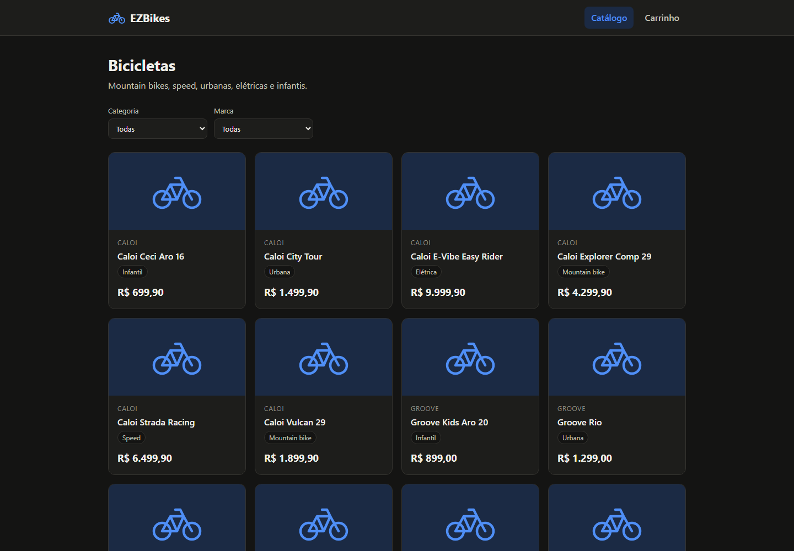 | 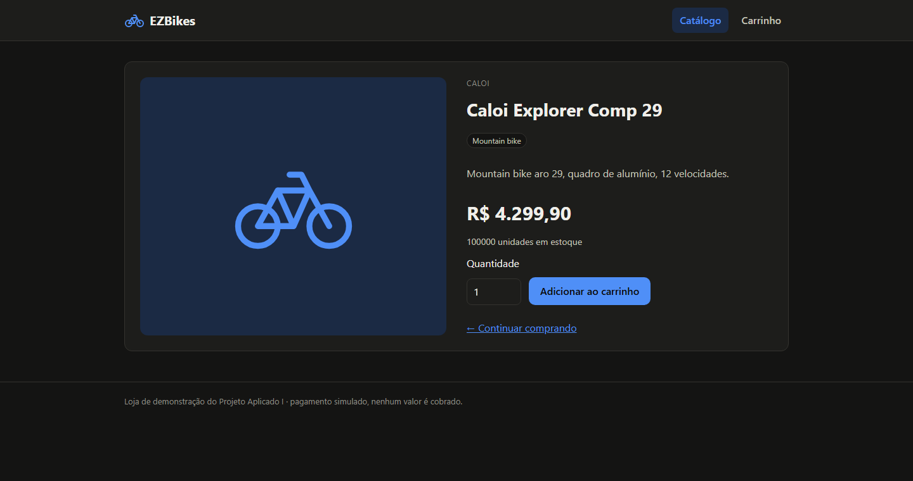 |
| **Catálogo** com filtros por categoria e marca | **Produto** com quantidade e carrinho |

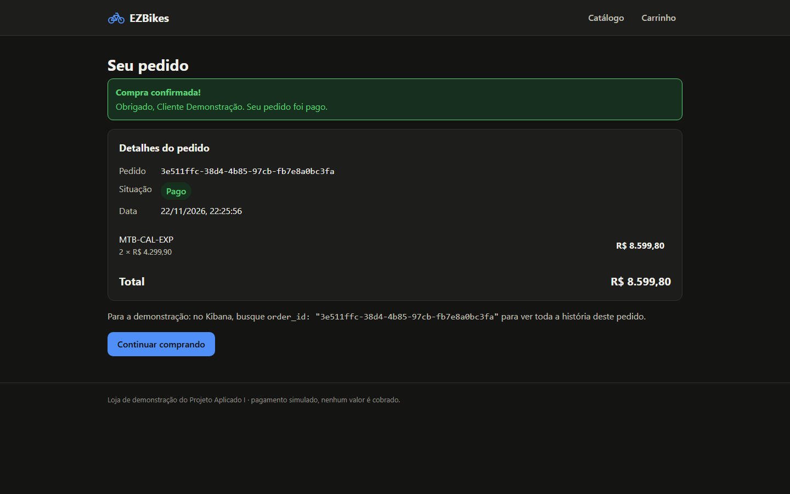

**Pedido confirmado**: mostra o número do pedido e a busca pronta para o Kibana.

### Grafana

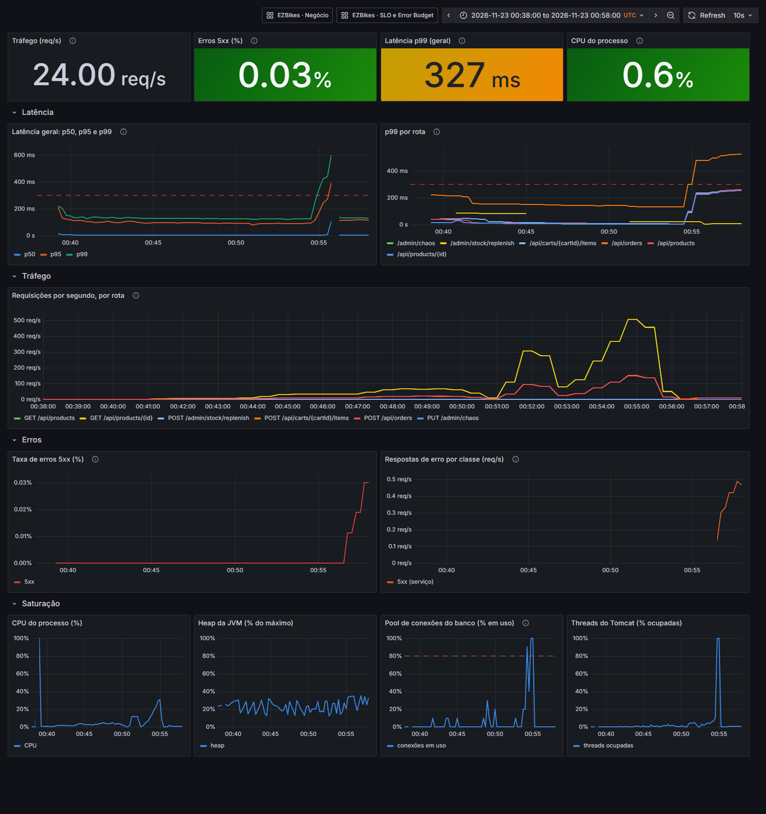

**Golden Signals durante `load.js`, `spike.js` e `stress.js` (00:38 a 00:58).** Tráfego em degraus, o pico e o estresse por volta de 00:55. No fim, o pool de conexões do banco chega a 100% e as threads do Tomcat se esgotam, enquanto a latência sobe e a CPU fica baixa.

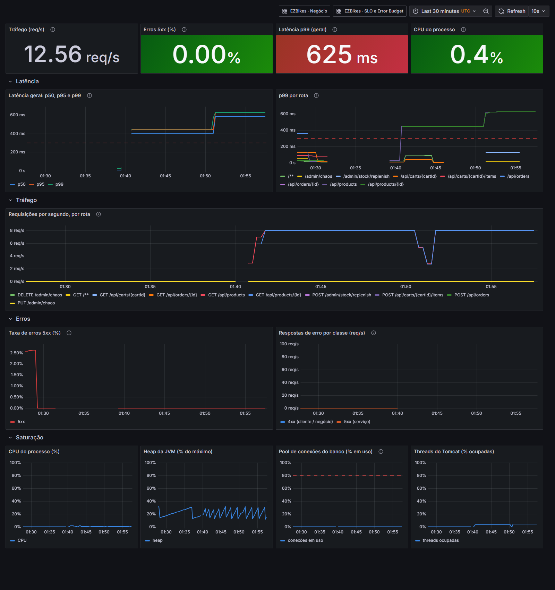

**Golden Signals durante o experimento de latência (400 ms e depois 600 ms extras no catálogo).** O p99 das rotas do catálogo vai a ~430 ms a partir de 01:40 e a 625 ms depois de 01:51. A saturação continua baixa (CPU < 1%, pool do banco vazio, poucas threads): a lentidão vem de fora, não de recurso esgotado. Comparado ao print anterior, os painéis de saturação são o que separa os dois diagnósticos.

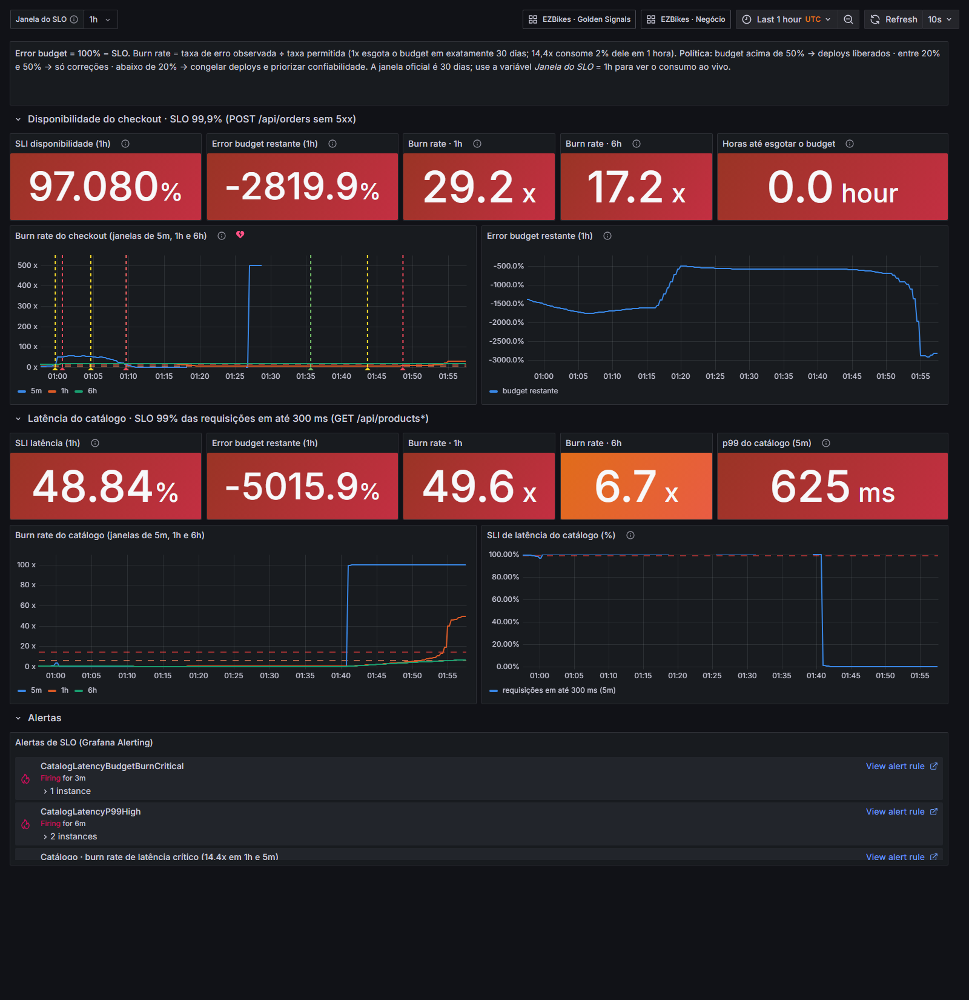

**SLO e Error Budget (janela de 1h) com os alertas de latência do catálogo disparando.** O burn rate de 5m vai a 100x às 01:40, mas o de 1h só passa de 14,4x depois de 01:52 (veja [experimento-caos.md](experimento-caos.md)). No gráfico do checkout aparecem as anotações dos alertas anteriores (linhas verticais) e o pico de 01:27, quando a falha de pagamento foi forçada para testar a mensagem da vitrine.

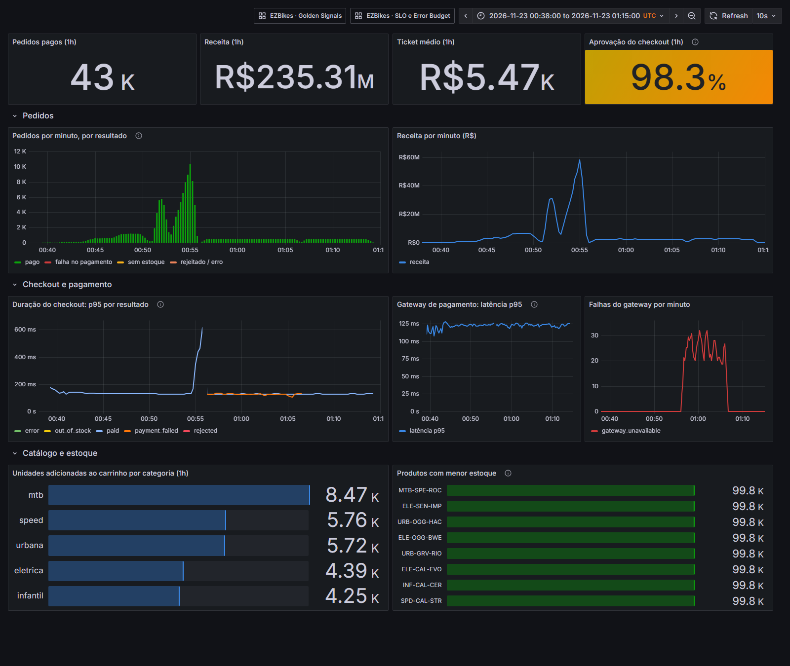

**Negócio durante os testes de carga e o experimento de falha no pagamento (00:38 a 01:15).** Pedidos e receita acompanham a carga; as falhas do gateway aparecem só entre 00:56 e 01:06, o período em que a falha de 5% estava ligada.

### Prometheus

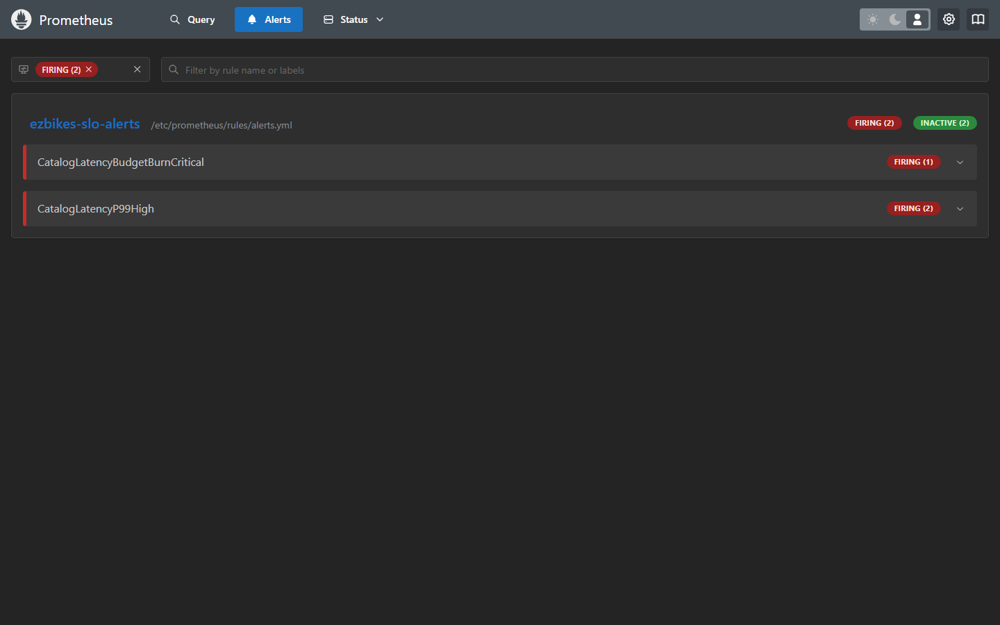

**Alertas avaliados pelo próprio Prometheus** (espelho das regras do Grafana), com os dois alertas do catálogo disparando.

### Kibana

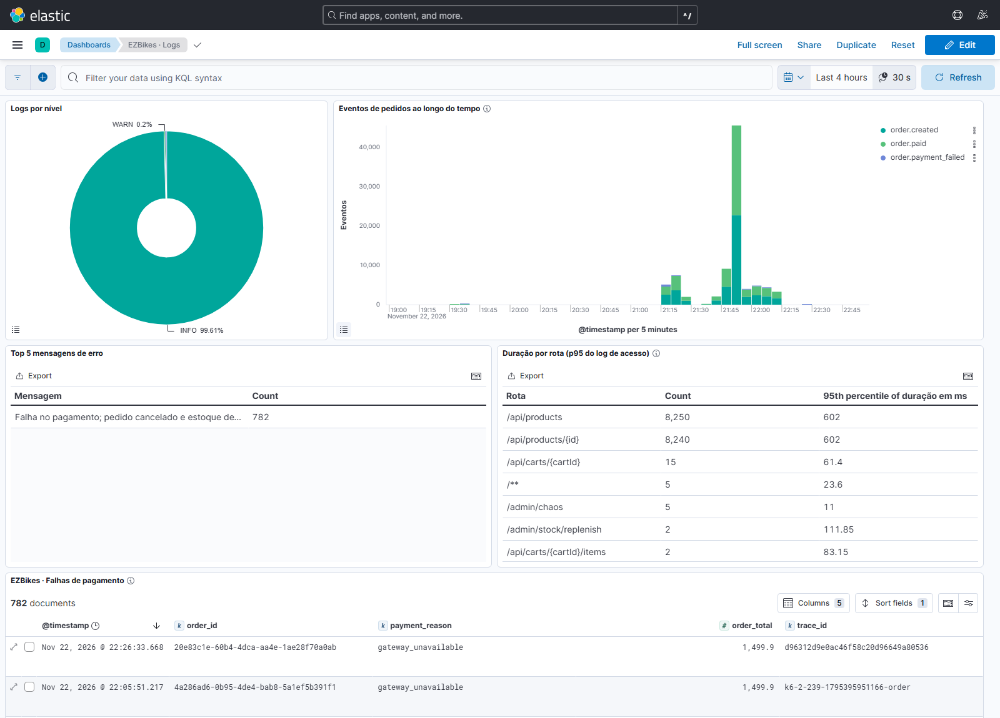

**Dashboard EZBikes · Logs**: logs por nível, eventos de pedidos ao longo do tempo, top 5 mensagens de erro, duração por rota (o catálogo com ~400 ms durante o experimento) e falhas de pagamento.

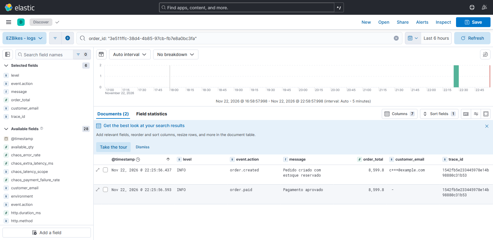

**História de um pedido** (`order_id`): criação e pagamento, com o e-mail mascarado (`c***@example.com`).

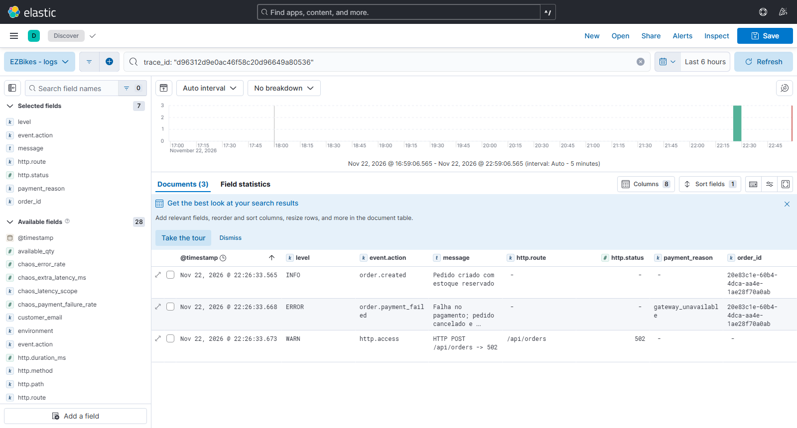

**Código de atendimento** (`trace_id`) exibido na vitrine quando o pagamento falhou: leva direto às três linhas da tentativa (pedido criado, falha `gateway_unavailable` e acesso `POST /api/orders` com 502).
